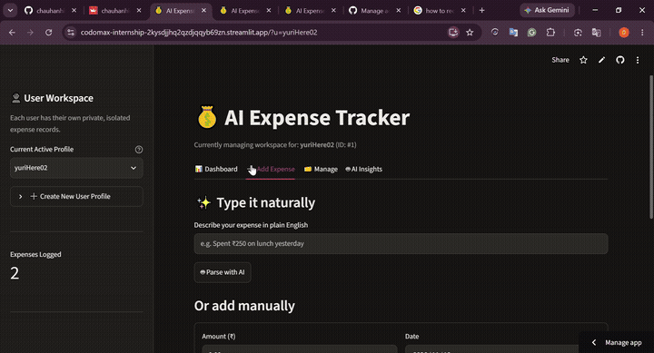
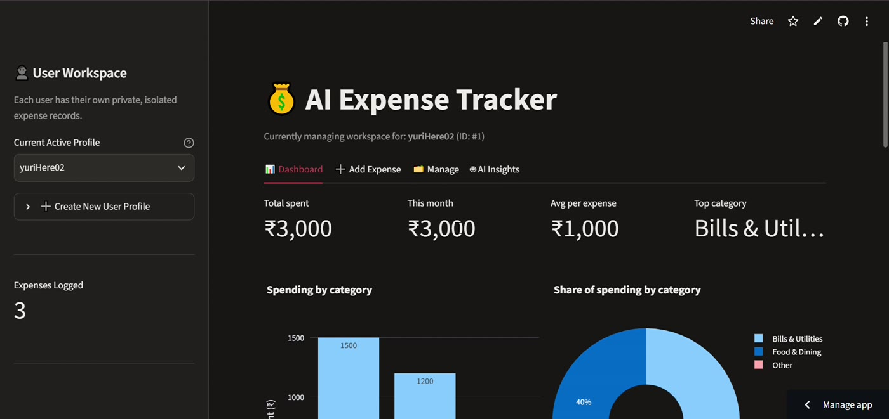
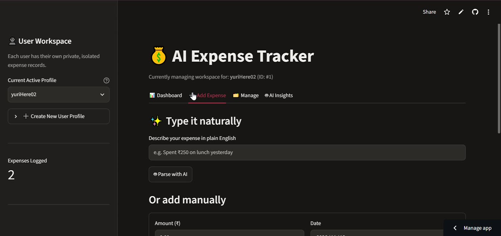
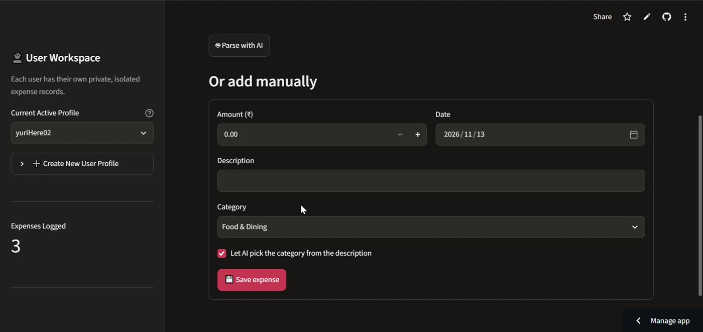
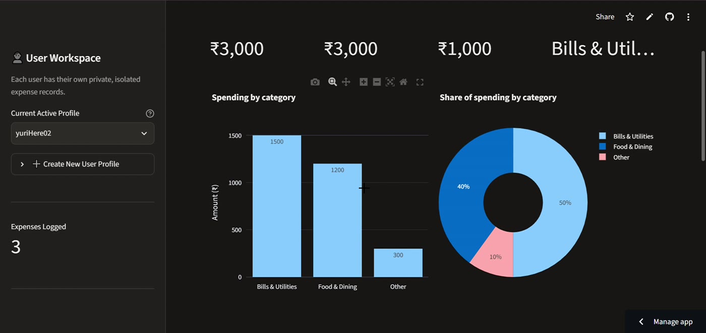
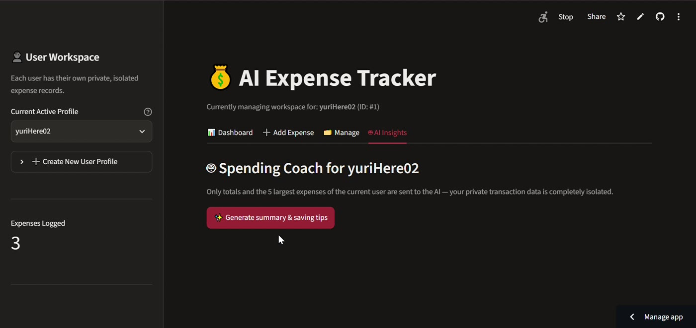
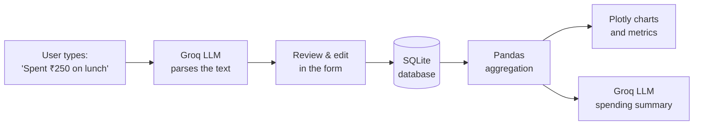

<div align="center">

# 💰 AI Expense Tracker

**Type an expense in plain English. Let AI categorize it, chart it, and coach you on saving.**

[](https://codomax-internship-2kysdjjhq2qzdjqqyb69zn.streamlit.app/)


### 🔗 [**Try the live app →**](https://codomax-internship-2kysdjjhq2qzdjqqyb69zn.streamlit.app/)

</div>

---

## 🎬 Demo

[](assets/demo.mp4)

▶️ **[Watch the full 1-minute walkthrough](assets/demo.mp4)**

---

## ✨ Features

| | Feature | Description |
|---|---|---|
| ➕ | **Add / Edit / Delete / View** | Full CRUD on your expenses, with a confirmation step before deleting |
| 🗣️ | **Natural-language entry** | Type *"Spent ₹250 on lunch yesterday"* and the amount, description, category and date are filled in for you |
| 🏷️ | **AI auto-categorization** | The LLM assigns one of 10 categories; a keyword fallback keeps the app working if the API is down |
| 💾 | **Persistent storage** | Expenses are stored in a SQLite database |
| 🧮 | **Spending analytics** | Total, this-month, average per expense and top category, plus monthly and category-wise tables |
| 📊 | **Interactive charts** | Bar chart (by category), pie/donut chart (share of spending) and line chart (monthly or daily trend) |
| 🤖 | **AI Spending Coach** | One click generates a summary, key observations and practical saving suggestions |
| 👤 | **User workspaces** | Each profile gets its own separate set of expense records |
| 🛡️ | **Validation and error handling** | Amount, description, category and date are all checked before saving; API errors never crash the app |
| 🔐 | **Secure API key handling** | The key lives in environment variables or Streamlit Secrets, never in the code |

---

## 📸 Screenshots

### Dashboard


### Natural-language entry


### Manage expenses (edit / delete)


### Spending trend


### AI Spending Coach


---

## 🧠 How It Works



1. **Parse:** the LLM turns free text into structured JSON (amount, description, category, date).
2. **Review:** you can correct anything before it is saved. The AI never writes to the database on its own.
3. **Store:** validated records go into SQLite using parameterized queries.
4. **Analyze:** Pandas groups the data by month and category.
5. **Advise:** only aggregated totals and the 5 largest expenses are sent to the LLM, not your full transaction history.

---

## 🗂️ Project Structure

```
ai_expense_tracker/
├── app.py              # Streamlit UI (tabs: Dashboard, Add, Manage, AI Insights)
├── auth.py             # User profiles / workspace handling
├── database.py         # SQLite: create, add, edit, delete, read + validation
├── ai_helper.py        # LLM calls: parsing, categorization, summaries (+ offline fallback)
├── charts.py           # Plotly bar, pie and line charts
├── config.py           # Categories, settings, secure key loading
├── requirements.txt    # Python dependencies
├── .env.example        # Template for local secrets
├── assets/             # Demo video, GIF and screenshots used in this README
└── README.md
```

---

## 🚀 Run It Locally

**Prerequisites:** Python 3.10+ and a free [Groq API key](https://console.groq.com/keys).

```bash
# 1. Clone the repository
git clone https://github.com/chauhanhimans7-bot/Codomax-Internship.git
cd "Codomax-Internship/Module 05/ai_expense_tracker"

# 2. Create a virtual environment
python -m venv venv
source venv/bin/activate          # Windows: venv\Scripts\activate

# 3. Install dependencies
pip install -r requirements.txt

# 4. Add your API key
cp .env.example .env              # then open .env and paste your key

# 5. Run
streamlit run app.py
```

Your `.env` file should look like this:

```env
GROQ_API_KEY=your-groq-api-key-here
```

> The app still runs without a key. AI features then use simple keyword rules instead of the LLM.

---

## ☁️ Deploying on Streamlit Community Cloud

1. Push the project to GitHub (do **not** commit `.env`).
2. Go to [share.streamlit.io](https://share.streamlit.io) → **Create app** → **Deploy a public app from GitHub**.
3. Select your repository, branch (`main`) and the path to `app.py`.
   - ⚠️ Use a folder path **without spaces**. A space in a folder name (for example `Module 05`) breaks Streamlit Cloud's dependency installer.
4. Open **Advanced settings**, choose Python **3.12**, and add your secret:
   ```toml
   GROQ_API_KEY = "your-groq-api-key-here"
   ```
5. Click **Deploy**.

---

## 🔒 Security and Privacy

- API keys are never hard-coded. They are read from environment variables or Streamlit Secrets, and `.env` is git-ignored.
- All SQL uses parameterized queries to prevent SQL injection.
- All user input is validated before it touches the database.
- The AI receives only aggregated spending totals and the 5 largest expenses, not every raw record.

---

## ⚠️ Known Limitations

- **Temporary storage on Streamlit Cloud:** the app's disk is reset when it restarts or sleeps, so saved expenses may disappear. For permanent storage, swap SQLite for a hosted database (for example Supabase or Turso).
- **Profiles are not password-protected:** workspaces keep each profile's records separate, but this is not a full authentication system. Don't store sensitive data in the demo.
- **AI can be wrong:** always glance at the parsed values in the "Review & save" step before saving.

---

## 🛣️ Future Improvements

- [ ] Proper login with hashed passwords
- [ ] Hosted database for permanent cloud storage
- [ ] Monthly budgets with overspending alerts
- [ ] CSV / Excel import and export
- [ ] Receipt scanning with a vision model
- [ ] Recurring expenses

---

## 🛠️ Built With

[Python](https://www.python.org/) · [Streamlit](https://streamlit.io/) · [Pandas](https://pandas.pydata.org/) · [SQLite](https://www.sqlite.org/) · [Plotly](https://plotly.com/python/) · [Groq](https://groq.com/)

---

## 👤 Author

**Dev Chauhan**
BCA Student · Aspiring AI/ML Engineer

[](https://github.com/chauhanhimans7-bot)
[](https://www.linkedin.com/in/dev-chauhan06)

Built as part of the **Codomax Internship, Module 05**.

---

<div align="center">

⭐ If you found this useful, consider starring the repo!

</div>
